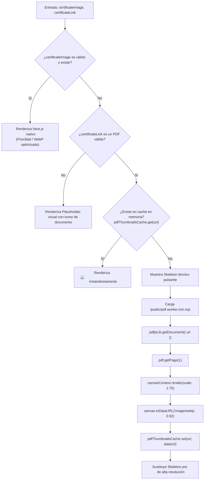

# Flujo de Datos y Modelo de Información
## Portafolio Profesional — Brandon Alberto Hualpa Butron

Este documento detalla la estructura formal de los datos, los contratos de tipado, el ciclo de vida de la información desde los archivos fuente hasta la interfaz de usuario, y los mecanismos de ordenamiento y caché implementados.

---

## 1. Esquemas de Datos y Contratos de Tipado

Toda la información del portafolio se almacena en archivos JSON en la carpeta `data/`. No existen bases de datos SQL/NoSQL remotas activas en tiempo de ejecución, lo que asegura tiempos de respuesta instantáneos y cero costos de infraestructura backend.

### 1.1. Esquema: Proyectos (`data/projects.json`)

```typescript
interface Project {
  id: number             // Identificador único numérico (1, 2, 3...)
  title: string          // Nombre del proyecto en mayúsculas o capitalizado
  category: string       // Categoría (Microservicios, Web App, Multiplayer, Hardware & OS, Enterprise Java)
  description: string    // Resumen detallado de la arquitectura y alcance
  image: string          // Ruta a la miniatura en public (ej: /images/proyectos/1.png)
  technologies: string[] // Array de tecnologías usadas (ej: ["Python", "Flask", "Docker"])
  github: string         // URL al repositorio de GitHub o "#" si es privado/demostrativo
  demo: string           // URL a la demo en vivo, video o carpeta en Drive
  video: string          // URL de inserción de YouTube (embed) o enlace directo
}
```

### 1.2. Esquema: Certificados (`data/certificates.json`)

```typescript
interface Certificate {
  id: number                 // Identificador único correlativo
  title: string              // Título oficial de la certificación
  organization: string       // Institución emisora (UNI, UTP, BIG school...)
  year: number               // Año de emisión (ej: 2026, 2024)
  certificateLink: string    // Ruta al PDF original en /public/documentos-pdf/certificados/
  certificateImage?: string  // Ruta a imagen estática opcional en /public/images/certificados/
}
```

### 1.3. Esquema: Habilidades Técnicas (`data/skills.json`)

```typescript
interface SkillCategory {
  category: string  // Nombre del segmento (Programación, Frontend, Backend, Bases de Datos, DevOps...)
  items: string[]   // Lista de tecnologías que componen la categoría
}
```

### 1.4. Esquema: Títulos Académicos (`data/titulos-academicos.json`)

```typescript
interface AcademicDegree {
  id: number
  key: string          // Clave de identificación ("bachiller", "egresado", "titulo")
  tabLabel: string     // Texto de la pestaña en la consola
  badgeLabel: string   // Texto de verificación en el badge superior
  degreeType: string   // Tipo de acreditación académica
  title: string        // Nombre del grado o certificado
  institution: string  // Institución (ej: Universidad Tecnológica del Perú)
  year: number         // Año de expedición
  status: string       // Estado del documento ("Verificado", "Disponible", "En proceso")
  description: string  // Explicación curricular detallada
  documentUrl: string  // Ruta al documento descargable o visor
  previewImage: string // Ruta a la miniatura visual
}
```

---

## 2. Diagrama de Flujo de Datos

```mermaid
flowchart TD
    subgraph Storage["Fuentes de Verdad Locales (Disco)"]
        PJ["data/projects.json"]
        CF["data/certificates.json"]
        SK["data/skills.json"]
        TA["data/titulos-academicos.json"]
        CV["lib/cv-document.ts"]
    end

    subgraph RuntimeEngine["Procesamiento en Tiempo de Ejecución"]
        SortP["Ordenamiento Ascendente por ID: a.id - b.id"]
        SortC["Ordenamiento Ascendente por ID: a.id - b.id"]
        HashState["Mapeador de Vistas: HASH_TO_VIEW / Atajos 1-6"]
        PdfWorker["Motor pdfjs-dist (Página 1 a Canvas)"]
        Cache["Caché en Memoria: pdfThumbnailsCache (Map)"]
    end

    subgraph Views["Vistas de Presentación (DOM)"]
        PGrid["components/ProjectsGrid.tsx"]
        PPage["app/projects/[id]/page.tsx"]
        CGrid["components/CertificatesGrid.tsx"]
        CPage["app/certificates/[id]/page.tsx"]
        SComp["components/Skills.tsx"]
        AComp["components/AcademicDegrees.tsx"]
        Modal["components/DocumentModal.tsx"]
    end

    PJ --> SortP
    SortP -->|Array ordenado| PGrid
    SortP -->|Elemento por ID + Prev/Next| PPage

    CF --> SortC
    SortC -->|Paginación (6 por vista)| CGrid
    SortC -->|Detalle + Lightbox| CPage

    CGrid --> PdfWorker
    CPage --> PdfWorker
    PdfWorker --> Cache
    Cache -->|WebP DataURL| CGrid
    Cache -->|WebP DataURL| CPage

    SK --> SComp
    TA --> AComp
    TA --> Modal
    CV --> Modal
```

---

## 3. Lógica de Ordenamiento y Modificación de Posiciones

Tanto los **proyectos** como las **certificaciones** implementan un principio arquitectónico estricto:

> **El orden visual en pantalla está gobernado por el atributo `"id"` numérico en orden ascendente (`a.id - b.id`), NO por el orden de aparición de las líneas en el archivo JSON.**

```typescript
// Implementado en ProjectsGrid.tsx, CertificatesGrid.tsx y páginas de detalle:
const items: T[] = [...(rawData as T[])].sort((a, b) => a.id - b.id)
```

### ¿Cómo reordenar o mover una tarjeta?
1. Abre `data/projects.json` o `data/certificates.json`.
2. Asigna el número de `"id"` más bajo (ej: `1`) al elemento que desees que aparezca en la primera posición.
3. Asegura que los IDs sigan una secuencia correlativa sin duplicados (`1, 2, 3, 4...`).
4. Al recargar, tanto el grid como la navegación correlativa (`Anterior` y `Siguiente`) respetarán el nuevo orden automáticamente.

---

## 4. Pipeline de Previsualización Inteligente de Documentos

El componente `CertificatePreview.tsx` implementa un algoritmo condicional de tres ramas para optimizar la carga de assets:



---

## 5. Gestión del Estado de la Aplicación

1. **Estado de Vista del Studio (`activeView`)**:
   - Administrado en `app/page.tsx` con `useState<WorkspaceView>('overview')`.
   - Se sincroniza con el hash de la URL mediante `window.history.replaceState(null, '', nextHash)`.
   - Permite que los enlaces directos (ej: `brandonbutron.dev/#projects`) abran directamente el workspace correcto al cargar la página.
2. **Estado del Tema (`dark` / `light`)**:
   - Administrado por `next-themes` en `components/theme-provider.tsx`.
   - Modifica directamente la clase en el elemento raíz `document.documentElement.classList`.
   - Persiste en `localStorage.getItem('theme')`.
3. **Estado de Paginación**:
   - Local en cada componente (`ProjectsGrid` mantiene `currentPage`, `CertificatesGrid` mantiene `currentPage`).
   - Se reinicia automáticamente cuando cambia el filtrado o la vista.

