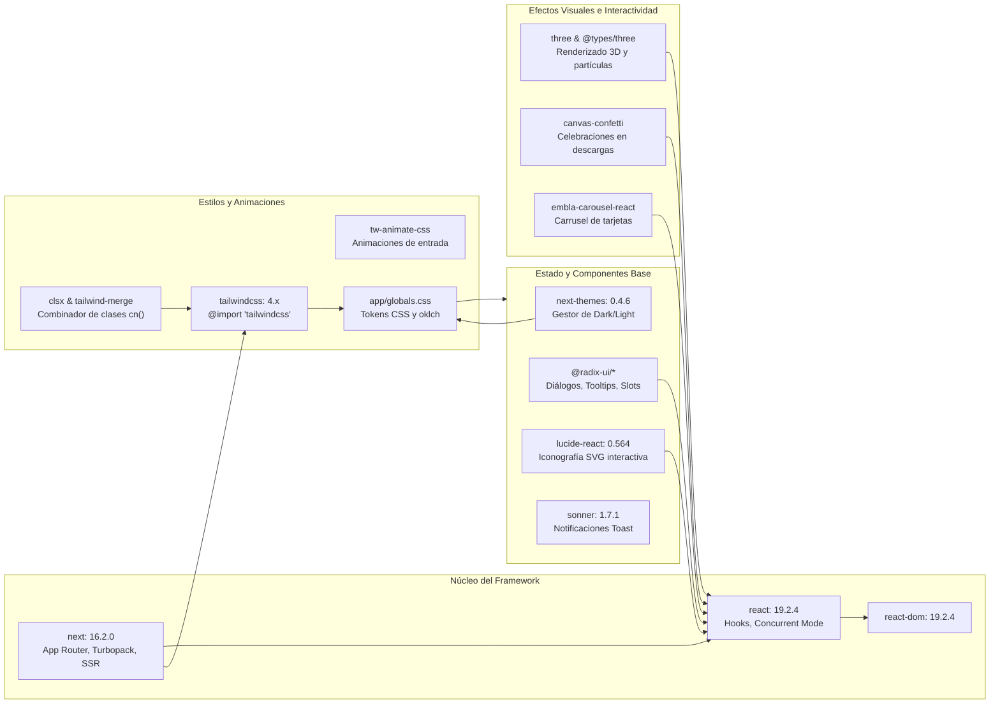
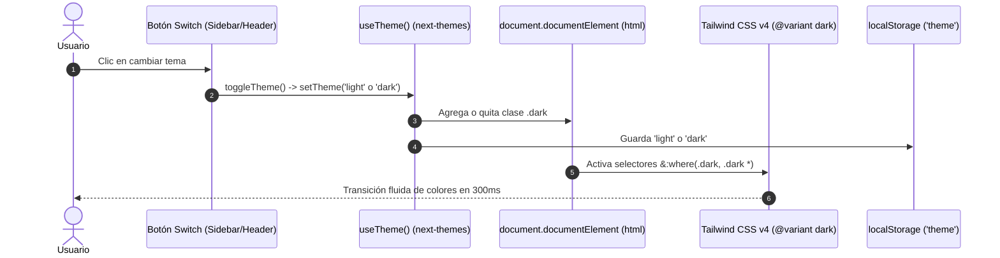
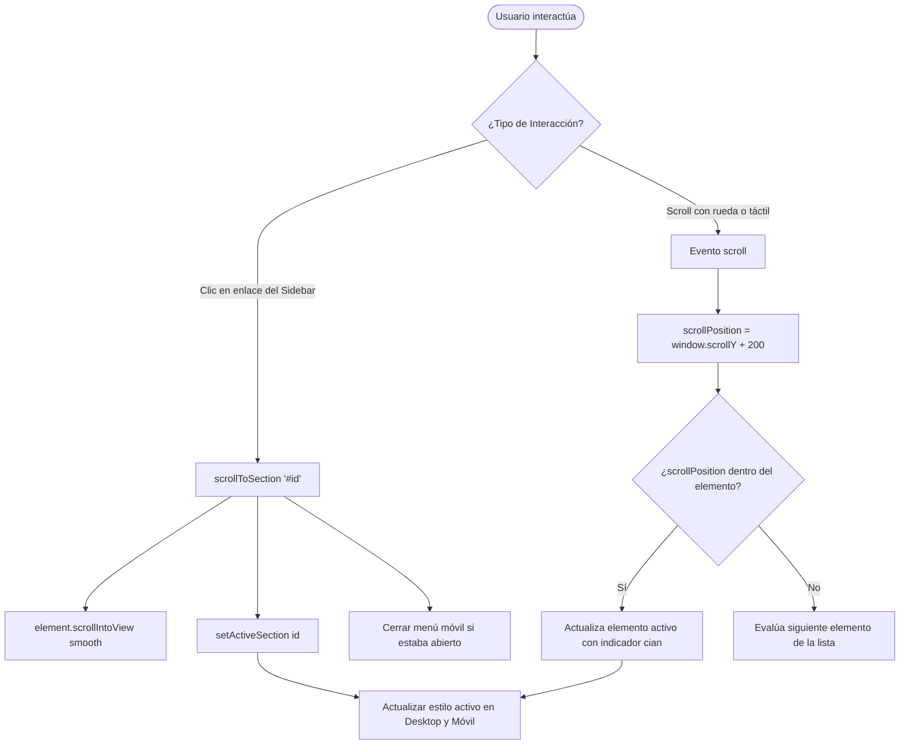

# Documentación Técnica, Arquitectura y Manual del Sistema
## Portafolio Profesional Cyber-Tech 3D — Brandon Alberto Hualpa Butron

Este documento detalla exhaustivamente el funcionamiento técnico, la arquitectura de diseño móvil y escritorio, la comunicación entre dependencias y bibliotecas mediante mapas conceptuales, y una guía práctica paso a paso para extender y actualizar las habilidades, certificados y proyectos del portafolio.

---

## 📑 Tabla de Contenidos

1. [Visión General y Propósito del Sistema](#1-visión-general-y-propósito-del-sistema)
2. [¿Cómo Funciona la Aplicación? (Arquitectura Técnica)](#2-cómo-funciona-la-aplicación-arquitectura-técnica)
   - [Ciclo de Vida y App Router en Next.js 16](#ciclo-de-vida-y-app-router-en-nextjs-16)
   - [Sistema de Temas Dinámico (Dark / Light Mode)](#sistema-de-temas-dinámico-dark--light-mode)
   - [Navegación Asíncrona y ScrollSpy](#navegación-asíncrona-y-scrollspy)
   - [Renderizado de Datos Desacoplado](#renderizado-de-datos-desacoplado)
3. [¿Cómo está Creada la Aplicación en Modo Móvil? (Mobile-First)](#3-cómo-está-creada-la-aplicación-en-modo-móvil-mobile-first)
   - [Estrategia de Breakpoints y Reestructuración de Layout](#estrategia-de-breakpoints-y-reestructuración-de-layout)
   - [Navegación Móvil: Header Sticky vs Sidebar Fijo](#navegación-móvil-header-sticky-vs-sidebar-fijo)
   - [Adaptación de Gráficos y Escenas 3D](#adaptación-de-gráficos-y-escenas-3d)
   - [Touch Targets y Ergonomía Visual](#touch-targets-y-ergonomía-visual)
4. [Comunicación entre Paquetes y Mapas Conceptuales](#4-comunicación-entre-paquetes-y-mapas-conceptuales)
   - [Mapa Conceptual 1: Arquitectura General y Flujo de Datos](#mapa-conceptual-1-arquitectura-general-y-flujo-de-datos)
   - [Mapa Conceptual 2: Ecosistema y Relación de Dependencias](#mapa-conceptual-2-ecosistema-y-relación-de-dependencias)
   - [Mapa Conceptual 3: Flujo de Ejecución del Cambio de Tema](#mapa-conceptual-3-flujo-de-ejecución-del-cambio-de-tema)
   - [Mapa Conceptual 4: Ciclo de Navegación y ScrollSpy](#mapa-conceptual-4-ciclo-de-navegación-y-scrollspy)
5. [Guía Paso a Paso para Agregar Contenido](#5-guía-paso-a-paso-para-agregar-contenido)
   - [Cómo agregar nuevas Habilidades](#cómo-agregar-nuevas-habilidades)
   - [Cómo agregar nuevos Certificados](#cómo-agregar-nuevos-certificados)
   - [Cómo agregar nuevos Proyectos](#cómo-agregar-nuevos-proyectos)
   - [Cómo agregar o modificar Títulos Académicos](#cómo-agregar-o-modificar-títulos-académicos)
6. [Comandos de Verificación y Buenas Prácticas](#6-comandos-de-verificación-y-buenas-prácticas)

---

## 1. Visión General y Propósito del Sistema

El portafolio representa la identidad profesional de **Brandon Alberto Hualpa Butron**, Egresado de **Ingeniería de Software de la Universidad Tecnológica del Perú (UTP 2019 - 2025)**, especializado en **Desarrollo Backend, Microservicios, APIs REST, Bases de Datos y Automatización con IA**.

### Principios de Diseño
- **Estética Cyber-Tech 3D**: Fondo azul marino ultra profundo (`#030713`), iluminación cian (`#00d2ff`), acentos azul eléctrico (`#3b82f6`) y violeta (`#a855f7`).
- **Doble Modo Coherente**: Tema oscuro de alto impacto tecnológico y tema claro limpio (`#f8fafc`) con contraste accesible.
- **Rendimiento Óptimo**: Turbopack, renderizado estático híbrido, cero lag en animaciones y carga instantánea de recursos PDF.
- **Transparencia Académica**: Constancia de egresado verificada, certificados con visualizadores embebidos y enlaces directos a código fuente en GitHub.

---

## 2. ¿Cómo Funciona la Aplicación? (Arquitectura Técnica)

### Ciclo de Vida y App Router en Next.js 16

La aplicación aprovecha la estructura de carpetas de **Next.js 16 App Router**:

```
app/
├── globals.css           # Tokens CSS globales, variables de tema y variantes Tailwind v4
├── layout.tsx            # Shell raíz: fuentes Geist, ThemeProvider, Analytics y botón flotante
├── page.tsx              # Página principal compuesta por todas las secciones modulares
├── projects/
│   └── [id]/page.tsx     # Ruta dinámica para detalle completo de cada proyecto
└── certificates/
    └── [id]/page.tsx     # Ruta dinámica para detalle completo de cada certificado
```

1. **Petición del Navegador**: El navegador solicita `GET /`.
2. **Layout Raíz (`app/layout.tsx`)**:
   - Inyecta las tipografías optimizadas `Geist Sans` y `Geist Mono`.
   - Envuelve el árbol de componentes con `<ThemeProvider attribute="class" defaultTheme="dark" enableSystem={false}>`.
   - Coloca componentes persistentes globales como el `<WhatsAppFloatButton />`.
3. **Página Principal (`app/page.tsx`)**:
   - Importa componentes modulares cliente (`'use client'`).
   - Deja un padding izquierdo compensatorio en desktop (`lg:pl-64`) para dar espacio al sidebar fijo.

### Sistema de Temas Dinámico (Dark / Light Mode)

El cambio de tema opera mediante tres capas coordinadas:

1. **Almacenamiento y Atributo HTML**: `next-themes` escucha el evento del interruptor y añade o remueve la clase `.dark` en la etiqueta raíz `<html>`. Además, persiste la elección en `localStorage` con la clave `'theme'`.
2. **Definición de Variantes en Tailwind CSS v4**:
   En `app/globals.css`, se define la regla:
   ```css
   @variant dark (&:where(.dark, .dark *));
   ```
   Esto asegura que tanto la raíz como cualquier elemento descendiente active las clases con prefijo `dark:` cuando la clase `.dark` esté presente.
3. **Tokens de Color Adaptativos**:
   - `:root` (Modo Claro): Fondo `#f8fafc`, tarjetas `#ffffff`, texto `#0f172a`, bordes `#e2e8f0`.
   - `.dark` (Modo Oscuro): Fondo `#030713`, tarjetas `#060d22`, texto `#f1f5f9`, bordes `rgba(59, 130, 246, 0.18)`.

### Navegación Asíncrona y ScrollSpy

En `components/Sidebar.tsx`, un `EventListener` monitorea el desplazamiento de la ventana con un umbral compensatorio:
```typescript
const handleScroll = () => {
  const scrollPosition = window.scrollY + 200
  for (const item of navItems) {
    const id = item.href.replace('#', '')
    const element = document.getElementById(id)
    if (element) {
      const top = element.offsetTop
      const height = element.offsetHeight
      if (scrollPosition >= top && scrollPosition < top + height) {
        setActiveSection(id)
        break
      }
    }
  }
}
```
Esto actualiza dinámicamente qué sección está activa tanto al hacer clic en los enlaces como al desplazarse manualmente por la página.

### Renderizado de Datos Desacoplado

Todo el contenido editable reside en archivos JSON estructurados en la carpeta `/data`:
- `data/skills.json` → Alimentado a `components/Skills.tsx`.
- `data/certificates.json` → Alimentado a `components/CertificatesGrid.tsx`.
- `data/projects.json` → Alimentado a `components/ProjectsGrid.tsx`.
- `data/titulos-academicos.json` → Alimentado a `components/AcademicDegrees.tsx`.

Esto desacopla por completo la lógica visual del contenido, permitiendo editar datos sin tocar código TypeScript.

---

## 3. ¿Cómo está Creada la Aplicación en Modo Móvil? (Mobile-First)

La experiencia móvil fue diseñada para que el sitio funcione fluidamente en cualquier pantalla pequeña (desde 360px de ancho) sin pérdidas funcionales ni desbordamientos horizontales.

### Estrategia de Breakpoints y Reestructuración de Layout

Se utiliza la convención de Tailwind CSS con el punto de quiebre principal en `lg:` (1024px):

| Elemento | En Móvil / Tablet (`< 1024px`) | En Desktop (`>= 1024px`) |
| :--- | :--- | :--- |
| **Navegación** | Encabezado superior pegajoso (`sticky top-0`) con menú hamburguesa deslizable. | Barra lateral fija a la izquierda (`fixed left-0 top-0 bottom-0 w-64`). |
| **Contenido Principal** | Ocupa el 100% del ancho (`w-full px-4`). | Desplazado 256px hacia la derecha (`lg:pl-64`). |
| **Escena 3D Hero** | Caja visual con altura acotada (`h-[320px]` a `h-[380px]`) centrada con partículas adaptadas. | Panel derecho de 2 columnas (`lg:grid-cols-12`) con tilt parallax 3D interactivo. |
| **Grid de Proyectos** | 1 columna por tarjeta con scroll vertical fluido. | 2 a 3 columnas con vista de carrusel y botones de navegación. |
| **Grid de Habilidades**| Tarjetas a 1 columna o 2 columnas compactas. | 3 columnas simétricas con iconografía por categoría. |

### Navegación Móvil: Header Sticky vs Sidebar Fijo

En [`components/Sidebar.tsx`](file:///e:/Proyectos/brandon-butron-dev-portfolio-mejorar/components/Sidebar.tsx), se renderizan dos estructuras complementarias:
1. `<aside className="hidden lg:flex ...">`: Solo existe en pantallas grandes.
2. `<header className="lg:hidden sticky top-0 ...">`:
   - Muestra el isotipo "B", el nombre y título profesional.
   - Contiene el interruptor rápido de modo oscuro/claro para móviles.
   - Contiene el botón hamburguesa (`Menu` / `X`) que despliega el menú vertical animado (`mobileMenuOpen`).
   - Al pulsar cualquier sección del menú móvil, la vista se desplaza con animación suave (`scrollIntoView({ behavior: 'smooth' })`) y el menú se cierra automáticamente.

### Adaptación de Gráficos y Escenas 3D

1. **Escena del Escritorio 3D (`components/Hero3DDesk.tsx`)**:
   - Utiliza capas con `backdrop-blur`, transformaciones CSS 3D (`transform-style: preserve-3d`) y aceleración por GPU.
   - En móviles, el efecto de tilt por cursor se desactiva elegantemente para evitar saltos bruscos y se optimiza la cantidad de partículas canvas en pantalla para ahorrar batería y memoria.
2. **Cubo 3D Interactivo (`components/GitHub3DCube.tsx`)**:
   - Las dimensiones se adaptan de `w-56 h-56` a contenedores proporcionales que no generan scroll horizontal.
   - Soporta rotación mediante eventos táctiles (`touchstart`, `touchmove`) además del cursor del mouse.

### Touch Targets y Ergonomía Visual

- **Tamaño de Toque Seguro**: Todos los botones de llamada a la acción (CTA), iconos de redes sociales y enlaces tienen un área de contacto mínima de `44 x 44 píxeles`.
- **Botón Flotante de WhatsApp (`components/WhatsAppFloatButton.tsx`)**:
  - Fijado en la esquina inferior derecha (`fixed bottom-6 right-6 z-50`).
  - Cuenta con un badge tooltip pulsante ("¡Hablemos por WhatsApp!").
  - Su posición respeta el área de navegación del pulgar sin tapar modales ni formularios.

---

## 4. Comunicación entre Paquetes y Mapas Conceptuales

### Mapa Conceptual 1: Arquitectura General y Flujo de Datos

```mermaid
flowchart TD
    subgraph DATA_LAYER["Capa de Datos (JSON Locales)"]
        D1[data/skills.json]
        D2[data/projects.json]
        D3[data/certificates.json]
        D4[data/titulos-academicos.json]
    end

    subgraph ENGINE["Motor Next.js 16 + React 19"]
        L[app/layout.tsx<br/>Fuentes, ThemeProvider, WhatsApp]
        P[app/page.tsx<br/>Home Page]
        R1[app/projects/[id]/page.tsx<br/>Detalle de Proyecto]
        R2[app/certificates/[id]/page.tsx<br/>Detalle de Certificado]
    end

    subgraph UI_COMPONENTS["Componentes de Interfaz"]
        C_NAV[components/Sidebar.tsx<br/>Desktop & Mobile Header]
        C_HERO[components/Hero.tsx + Hero3DDesk.tsx]
        C_ABOUT[components/About.tsx]
        C_GOALS[components/CurrentGoals.tsx]
        C_SKILLS[components/Skills.tsx]
        C_PROJ[components/ProjectsGrid.tsx]
        C_CUBE[components/GitHub3DCube.tsx]
        C_CERT[components/CertificatesGrid.tsx]
        C_DEG[components/AcademicDegrees.tsx]
        C_EDU[components/Education.tsx]
        C_CONT[components/Contact.tsx]
        C_FOOT[components/Footer.tsx]
        C_MODAL[components/DocumentModal.tsx]
    end

    subgraph CLIENT_BROWSER["Navegador del Usuario (DOM)"]
        DOM_DARK["Modo Oscuro Cyber-Tech (#030713)"]
        DOM_LIGHT["Modo Claro Profesional (#f8fafc)"]
        DOM_TOUCH["Interacciones Móviles Touch & Scroll"]
    end

    D1 --> C_SKILLS
    D2 --> C_PROJ
    D2 --> R1
    D3 --> C_CERT
    D3 --> R2
    D4 --> C_DEG

    L --> P
    P --> C_NAV
    P --> C_HERO
    P --> C_ABOUT
    P --> C_GOALS
    P --> C_SKILLS
    P --> C_PROJ
    P --> C_CUBE
    P --> C_CERT
    P --> C_DEG
    P --> C_EDU
    P --> C_CONT
    P --> C_FOOT

    C_CERT -.-> C_MODAL
    C_DEG -.-> C_MODAL

    UI_COMPONENTS --> DOM_DARK
    UI_COMPONENTS --> DOM_LIGHT
    UI_COMPONENTS --> DOM_TOUCH
```

---

### Mapa Conceptual 2: Ecosistema y Relación de Dependencias



---

### Mapa Conceptual 3: Flujo de Ejecución del Cambio de Tema



---

### Mapa Conceptual 4: Ciclo de Navegación y ScrollSpy



---

## 5. Guía Paso a Paso para Agregar Contenido

Esta sección es un manual de mantenimiento directo. Todo el contenido dinámico está diseñado para expandirse modificando únicamente los archivos de datos.

---

### Cómo agregar nuevas Habilidades

El listado de habilidades técnicas se gestiona en:
📁 [`data/skills.json`](file:///e:/Proyectos/brandon-butron-dev-portfolio-mejorar/data/skills.json)

#### Opción A: Agregar una habilidad a una categoría existente
Abre `data/skills.json`, localiza la categoría (por ejemplo `"Backend"`) y añade el nuevo texto al arreglo `"items"`:

```json
{
    "category": "Backend",
    "items": [
        "REST APIs",
        "Node.js",
        "Express.js",
        "Spring Boot",
        "FastAPI",
        "NestJS"  <-- Tu nueva habilidad añadida aquí
    ]
}
```

#### Opción B: Crear una nueva categoría completa
Si deseas agregar una nueva categoría (por ejemplo, "Inteligencia Artificial"):

1. Añade el nuevo bloque al final de `data/skills.json`:
   ```json
   {
       "category": "Inteligencia Artificial",
       "items": [
           "LangChain",
           "OpenAI API",
           "Hugging Face",
           "Ollama",
           "RAG Pipelines"
       ]
   }
   ```
2. *(Opcional)* En [`components/Skills.tsx`](file:///e:/Proyectos/brandon-butron-dev-portfolio-mejorar/components/Skills.tsx), puedes asociar un icono específico de `lucide-react` para la nueva categoría en el mapeo `getCategoryIcon()`:
   ```typescript
   case 'Inteligencia Artificial':
     return Brain
   ```

---

### Cómo agregar nuevos Certificados

El catálogo de certificados oficiales se gestiona en:
📁 [`data/certificates.json`](file:///e:/Proyectos/brandon-butron-dev-portfolio-mejorar/data/certificates.json)

#### 1. Preparar los archivos multimedia
- Guarda el archivo PDF descargable en:
  `public/documentos-pdf/certificados/NombreCertificado.pdf`
- Guarda la imagen de portada/miniatura (JPG/PNG) en:
  `public/images/certificados/NombreCertificado.jpg`

#### 2. Registrar el certificado en el JSON
Abre `data/certificates.json` y añade un nuevo objeto con un `id` único consecutivo:

```json
{
  "id": 6,
  "title": "Certificación en Arquitectura de Microservicios",
  "organization": "Universidad Tecnológica del Perú (UTP)",
  "year": 2025,
  "certificateLink": "/documentos-pdf/certificados/NombreCertificado.pdf",
  "certificateImage": "/images/certificados/NombreCertificado.jpg"
}
```

#### ¿Qué sucede automáticamente?
- Aparecerá inmediatamente en la sección de certificados con su insignia oficial.
- Se generará automáticamente el modal con visor interactivo del PDF y botón de descarga directa.
- Se habilitará la ruta dinámica `/certificates/6` automáticamente en Next.js.

---

### Cómo agregar nuevos Proyectos

La lista de proyectos se gestiona en:
📁 [`data/projects.json`](file:///e:/Proyectos/brandon-butron-dev-portfolio-mejorar/data/projects.json)

#### 1. Preparar la captura del proyecto
- Guarda la imagen promocional (captura de pantalla representativa) en:
  `public/images/proyectos/mi-nuevo-proyecto.png`

#### 2. Registrar el proyecto en el JSON
Abre `data/projects.json` y agrega un nuevo objeto:

```json
{
  "id": 5,
  "title": "Plataforma de Procesamiento Distribuido con Kafka",
  "description": "Arquitectura de streaming y procesamiento de eventos en tiempo real con Apache Kafka, microservicios en Java Spring Boot y persistencia en PostgreSQL con Docker Compose.",
  "image": "/images/proyectos/mi-nuevo-proyecto.png",
  "technologies": [
    "Java",
    "Spring Boot",
    "Apache Kafka",
    "Docker",
    "PostgreSQL",
    "Microservicios"
  ],
  "github": "https://github.com/BrandonAlbertt/nombre-del-repo.git",
  "demo": "https://mi-demo-en-vivo.com",
  "video": "https://www.youtube.com/embed/CODIGO_DE_VIDEO_YOUTUBE"
}
```

#### Explicación de campos:
- `id`: Número identificador único. Next.js creará la subpágina `/projects/[id]` con este número.
- `title`: Título formal del proyecto.
- `description`: Resumen técnico enfocado en problemáticas resueltas, arquitectura y valor.
- `image`: Ruta relativa dentro de `/public`.
- `technologies`: Arreglo de strings con las tecnologías clave. Se mostrarán como badges tecnológicos.
- `github`: Enlace directo al repositorio de código en GitHub.
- `demo`: Enlace a la demo en vivo, despliegue en la nube o video en Google Drive.
- `video`: Enlace de inserción de YouTube (`https://www.youtube.com/embed/...`). Al hacer clic en el botón "Video", abrirá la vista embebida.

---

### Cómo agregar o modificar Títulos Académicos

Los grados y títulos oficiales se gestionan en:
📁 [`data/titulos-academicos.json`](file:///e:/Proyectos/brandon-butron-dev-portfolio-mejorar/data/titulos-academicos.json)

Formato del archivo:
```json
[
  {
    "id": 1,
    "title": "Constancia de Egresado - Ingeniería de Software",
    "institution": "Universidad Tecnológica del Perú (UTP)",
    "year": 2025,
    "condition": "Egresado",
    "documentPdf": "/documentos-pdf/ConstanciadeEgresado.pdf",
    "image": "/images/grados/constancia-egresado.jpg",
    "description": "Documento oficial que acredita la culminación satisfactoria del plan de estudios de la carrera profesional de Ingeniería de Software (2019-2025)."
  }
]
```

---

## 6. Comandos de Verificación y Buenas Prácticas

Cada vez que agregues o modifiques contenido, sigue este flujo de trabajo para garantizar calidad:

### 1. Iniciar el entorno de desarrollo local
```bash
npm run dev
```
Abre `http://localhost:3000` en tu navegador y comprueba que los nuevos elementos se vean correctamente en modo claro y oscuro.

### 2. Comprobación estricta de TypeScript
```bash
npx tsc --noEmit
```
Debe finalizar con código `0` sin reportar errores de tipos.

### 3. Compilación de producción
```bash
npm run build
```
Next.js compilará todas las rutas estáticas y verificará la integridad de los componentes. Si el build genera el mensaje `✓ Compiled successfully`, el proyecto está 100% listo para ser publicado en Vercel, Netlify o cualquier servidor de producción.

---

*Manual elaborado con precisión técnica para el portafolio de Brandon Alberto Hualpa Butron.*
