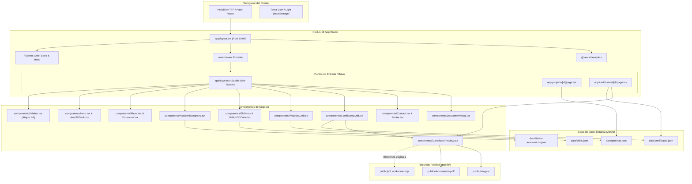
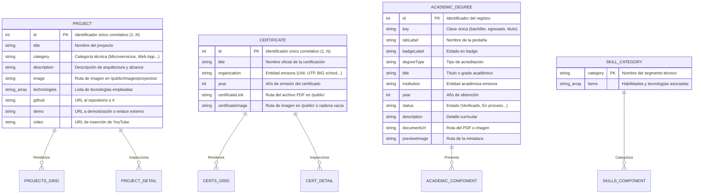
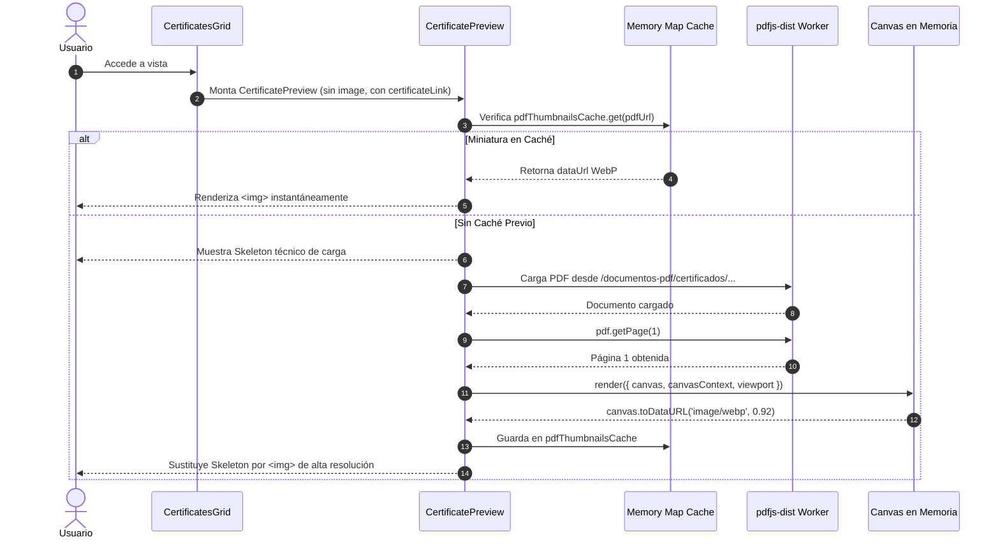
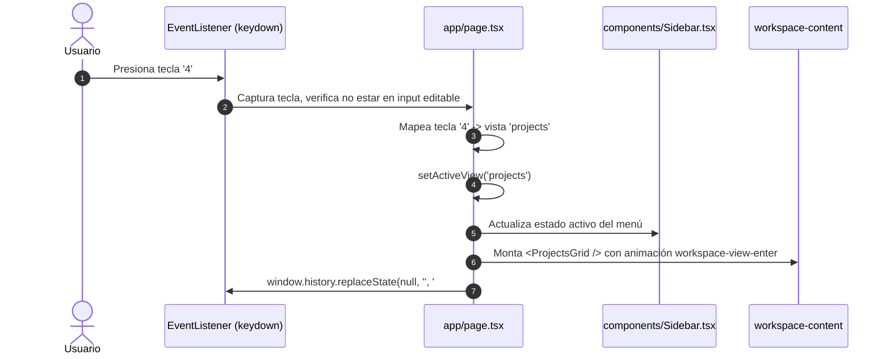
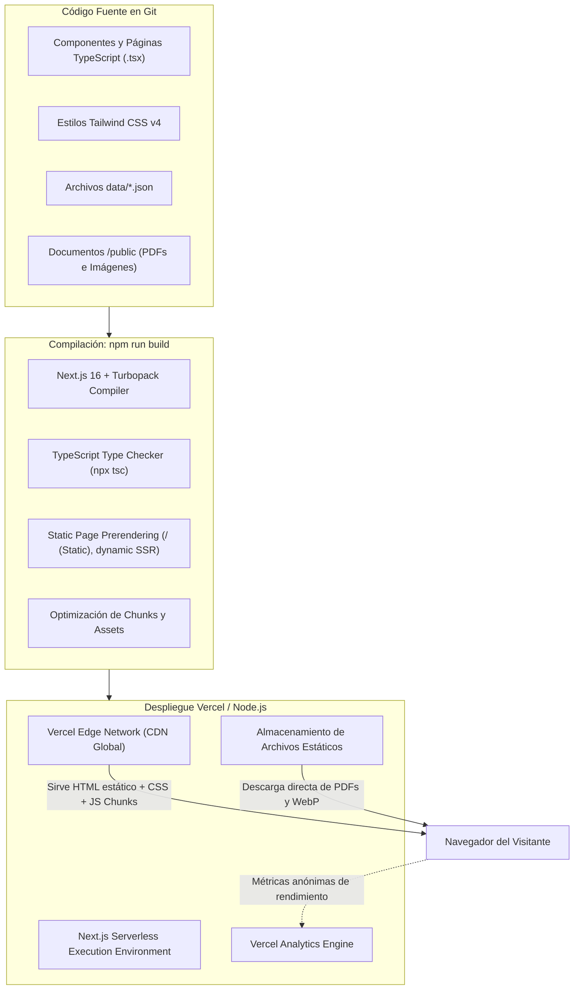

# Arquitectura del Sistema y Documentación Técnica
## Portafolio Profesional — Brandon Alberto Hualpa Butron

> **Documento Maestro de Arquitectura para Ingenieros de Software y Agentes de IA.**
> Generado bajo ingeniería inversa rigurosa sobre el código fuente real del repositorio `brandon-butron-dev-portfolio-mejorar`.

---

## 1. Descripción General del Proyecto

El proyecto es una aplicación web moderna de portafolio profesional desarrollada para **Brandon Alberto Hualpa Butron** (Bachiller en Ingeniería de Software, Universidad Tecnológica del Perú - UTP, 2019–2025), orientada a posicionar su perfil en **Desarrollo Backend, Microservicios, APIs REST, Arquitectura de Software y Automatización con IA**.

A nivel de interfaz y experiencia de usuario, el sitio implementa el paradigma **"Precision Backend Studio"**: un espacio de trabajo técnico inspirado en entornos de desarrollo e interfaces de telemetría, con un chasis concéntrico, menú lateral persistente con atajos de teclado (`1–6`), panel central dinámico, consolas dedicadas para inspección de proyectos y certificaciones, y un visor de documentos PDF impulsado por renderizado en Canvas vía `pdfjs-dist`.

---

## 2. Stack Tecnológico Real y Función de cada Tecnología

A continuación se detalla el inventario tecnológico verificado directamente en `package.json`, `tsconfig.json` y el código fuente:

| Tecnología | Versión Verificada | Propósito en el Proyecto | Ubicación y Uso Real |
| :--- | :--- | :--- | :--- |
| **Next.js** | `16.2.0` | Framework web fullstack con App Router y compilador **Turbopack**. Gestiona el enrutamiento híbrido, fuentes optimizadas y compilación. | Raíz, `app/layout.tsx`, `app/page.tsx`, `next.config.mjs` |
| **React** | `19.2.4` | Librería central de UI. Manejo de estado reactivo, hooks y renderizado del DOM en cliente. | Todos los componentes en `components/` y `app/` |
| **React DOM** | `19.2.4` | Integración de React con el árbol DOM del navegador y portales modales (`createPortal`). | `components/DocumentModal.tsx` |
| **TypeScript** | `^5` (Strict) | Tipado estático estricto, interfaces de datos y seguridad en tiempo de compilación. | `tsconfig.json`, `data.d.ts`, código fuente `.ts` y `.tsx` |
| **Tailwind CSS** | `^4.0.0` | Motor de estilos basado en utilidades, variables CSS semánticas y variantes dark mode personalizadas. | `app/globals.css`, `postcss.config.mjs` |
| **pdfjs-dist** | `^6.5.438` | Motor de renderizado de PDFs de Mozilla. Extrae la página 1 del PDF a un `<canvas>` en memoria y lo convierte a WebP limpio para previsualizaciones. | `components/CertificatePreview.tsx`, `public/pdf.worker.min.mjs` |
| **Radix UI** | `1.1.x – 2.2.x` | Primitivas de UI accesibles sin estilos (Dialog, Dropdown, Tabs, Tooltip, AspectRatio, Accordion). | `components/ui/` |
| **Lucide React** | `^0.564.0` | Set de iconos vectoriales limpios y consistentes. | Prácticamente en todos los componentes |
| **Next Themes** | `^0.4.6` | Gestión del tema `dark` / `light` con persistencia en `localStorage` y clase `.dark` en `<html>`. | `app/layout.tsx`, `components/theme-provider.tsx`, `components/Sidebar.tsx` |
| **clsx + twMerge** | `^2.1.1` / `^0.7.1` | Combinación condicional de clases CSS sin conflictos de especificidad (helper `cn`). | `lib/utils.ts`, `components/ui/*` |
| **@vercel/analytics**| `1.6.1` | Telemetría y analítica de visitas en entornos de producción Vercel. | `app/layout.tsx` |

> [!NOTE]
> **Dependencias no utilizadas activamente en el código:** `@types/three` está listado en dependencias, pero los componentes 3D (`GitHub3DCube.tsx`) operan mediante transformaciones puras de CSS 3D (`preserve-3d`, `rotateX/Y`), evitando la sobrecarga de un bundle Three.js en cliente.

---

## 3. Estructura de Directorios

```text
brandon-butron-dev-portfolio-mejorar/
├── .agents/                               # Configuración de herramientas y skills para agentes
│   └── skills/
│       ├── frontend-design/               # Guía de diseño visual e identidad
│       ├── redesign-existing-projects/    # Metodología de auditoría y rediseño
│       └── uigraph/                       # Skill UIGraph para mapeo de arquitectura
│
├── app/                                   # Next.js 16 App Router
│   ├── certificates/
│   │   └── [id]/
│   │       └── page.tsx                   # Consola técnica de detalle de certificado
│   ├── projects/
│   │   └── [id]/
│   │       └── page.tsx                   # Consola técnica de detalle de proyecto
│   ├── apple-icon.tsx                     # Generador dinámico de icono iOS
│   ├── icon.tsx                           # Generador dinámico de favicon
│   ├── globals.css                        # Tokens CSS, temas dark/light, utilidades studio
│   ├── layout.tsx                         # Root Layout (fuentes Geist, ThemeProvider, Analytics)
│   └── page.tsx                           # Página principal del Studio con enrutador hash
│
├── components/                            # Componentes de UI de negocio
│   ├── About.tsx                          # Sección Sobre Mí
│   ├── AcademicDegrees.tsx                # Grados académicos (Bachiller, Egresado, Título)
│   ├── CertificatePreview.tsx             # Previsualizador Canvas/WebP vía PDF.js
│   ├── CertificatesGrid.tsx               # Grid paginado de certificaciones (ordenado por id)
│   ├── Contact.tsx                        # Canales de comunicación y formulario
│   ├── CurrentGoals.tsx                   # Roadmap técnico actual
│   ├── CvQuickButton.tsx                  # Botón pill de acceso rápido al CV
│   ├── DocumentModal.tsx                  # Modal con visor embebido de documentos
│   ├── Education.tsx                      # Trayectoria universitaria UTP
│   ├── Footer.tsx                         # Pie de página técnico
│   ├── GitHub3DCube.tsx                   # Cubo 3D interactivo en CSS 3D
│   ├── GitHubReposDropdown.tsx            # Selector desplegable de repositorios
│   ├── Hero.tsx                           # Encabezado principal y presentación
│   ├── Hero3DDesk.tsx                     # Ilustración 3D del espacio de trabajo
│   ├── Navbar.tsx                         # Barra superior alternativa
│   ├── ProjectsGrid.tsx                   # Grid paginado de proyectos (ordenado por id)
│   ├── Sidebar.tsx                        # Barra lateral persistente con atajos 1–6
│   ├── Skills.tsx                         # Inventario de habilidades por categorías
│   ├── theme-provider.tsx                 # Envoltura de next-themes
│   ├── WhatsAppFloatButton.tsx            # Botón flotante de WhatsApp
│   └── ui/                                # Primitivas de diseño atómico (Radix UI / Tailwind)
│
├── data/                                  # Fuente de verdad de datos estáticos
│   ├── certificates.json                  # Catálogo de certificaciones
│   ├── projects.json                      # Catálogo de proyectos de software
│   ├── skills.json                        # Inventario de habilidades técnicas
│   └── titulos-academicos.json            # Registro de acreditaciones académicas
│
├── docs/                                  # Documentación de arquitectura del sistema
│   ├── PROJECT_ARCHITECTURE.md            # Este documento maestro
│   ├── COMPONENT_MAP.md                   # Mapa exhaustivo de componentes
│   ├── DATA_FLOW.md                       # Flujo y ciclos de datos
│   ├── AI_DEVELOPMENT_GUIDE.md            # Guía y protocolo para agentes de IA
│   └── MANUAL_DE_DESARROLLO_Y_ARQUITECTURA.md
│
├── hooks/                                 # Custom hooks de React (use-mobile, use-toast)
├── lib/                                   # Utilidades (cn, cv-document, brand-icon)
├── public/                                # Activos estáticos públicos
│   ├── documentos-pdf/                    # PDFs originales (certificados, CV, títulos)
│   ├── images/                            # Imágenes de proyectos, certificados y perfil
│   └── pdf.worker.min.mjs                 # Worker local de Mozilla PDF.js v6
├── next.config.mjs                        # Configuración de compilación Turbopack y Next.js
├── package.json                           # Manifiesto de paquetes npm
└── tsconfig.json                          # Configuración estricta de TypeScript
```

---

## 4. Arquitectura General del Sistema

El sistema implementa una arquitectura **JAMstack desacoplada y orientada a cliente (Client-Driven Static Shell)** optimizada con Server-Side Pre-rendering estático durante el build de Next.js:

1. **Capa de Shell y Layout (`app/layout.tsx`)**: Inicializa el proveedor de temas `next-themes`, las tipografías locales Geist (`--font-geist-sans`, `--font-geist-mono`) y la telemetría de Vercel.
2. **Capa de Enrutamiento Híbrido**:
   - **Ruta Principal (`/`)**: Actúa como un estudio interactivo monolítico (`app/page.tsx`). Controla la vista activa (`overview`, `about`, `skills`, `projects`, `certificates`, `contact`) mediante sincronización bidireccional entre estado React, atajos de teclado (`1–6`) y el hash de la URL (`#hero`, `#about`, etc.).
   - **Rutas Dinámicas (`/projects/[id]`, `/certificates/[id]`)**: Páginas individuales con su propia barra de navegación, migas de pan, consolas de inspección técnica bento y paginador correlativo anterior/siguiente.
3. **Capa de Datos Local (`data/*.json`)**: Todo el contenido está completamente desacoplado del código JSX. Los componentes importan directamente archivos JSON estáticos, garantizando tiempos de carga de 0ms sin requerir latencia de red hacia bases de datos externas.
4. **Capa de Visualización de Documentos**:
   - Si existe imagen estática (`certificateImage`), se renderiza mediante `next/image`.
   - Si no existe imagen estática pero sí PDF (`certificateLink`), `CertificatePreview.tsx` invoca dinámicamente `pdfjs-dist` en un `useEffect`, renderiza la página 1 en un `<canvas>` oculto a escala 1.75 y genera un blob en base64 WebP cacheado en memoria (`Map<string, string>`).

---

## 5. Diagramas Gráficos del Sistema (Mermaid)

### A. Mapa General del Sistema



---

### B. Diagrama de Componentes

```mermaid
graph TD
    Home["app/page.tsx"] --> Sidebar["components/Sidebar.tsx"]
    Home --> TopBar["Top Workspace Bar (Terminal breadcrumbs)"]
    Home --> CvBtn["components/CvQuickButton.tsx"]
    Home --> DocModal["components/DocumentModal.tsx"]

    subgraph OverviewView["Vista: overview (Atajo 1)"]
        Home --> Hero["components/Hero.tsx"]
        Hero --> Hero3D["components/Hero3DDesk.tsx"]
        Home --> Goals["components/CurrentGoals.tsx"]
    end

    subgraph AboutView["Vista: about (Atajo 2)"]
        Home --> About["components/About.tsx"]
        Home --> Education["components/Education.tsx"]
        Home --> Degrees["components/AcademicDegrees.tsx"]
    end

    subgraph SkillsView["Vista: skills (Atajo 3)"]
        Home --> Skills["components/Skills.tsx"]
        Home --> Cube3D["components/GitHub3DCube.tsx"]
    end

    subgraph ProjectsView["Vista: projects (Atajo 4)"]
        Home --> PGrid["components/ProjectsGrid.tsx"]
    end

    subgraph CertsView["Vista: certificates (Atajo 5)"]
        Home --> CGrid["components/CertificatesGrid.tsx"]
        CGrid --> CPreview["components/CertificatePreview.tsx"]
    end

    subgraph ContactView["Vista: contact (Atajo 6)"]
        Home --> Contact["components/Contact.tsx"]
        Home --> Footer["components/Footer.tsx"]
    end

    subgraph ProjectPage["app/projects/[id]/page.tsx"]
        PPageNav["Navegación Anterior/Siguiente"]
        PPageMedia["Consola de Medios (YouTube iframe / Image)"]
        PPageSpecs["Bento de Tecnologías y Repositorios"]
    end

    subgraph CertPage["app/certificates/[id]/page.tsx"]
        CPagePreview["CertificatePreview (Canvas / Image)"]
        CPageSpecs["Tabla de Atributos Técnicos"]
        CPageLightbox["Modal de Ampliación Lightbox"]
    end
```



---

### C. Diagrama de Rutas y Páginas

```mermaid
flowchart LR
    Root["/"] -->|app/page.tsx| HomeView["Consola Principal del Portafolio<br/>Controla 6 Vistas vía Hash State"]
    
    HomeView -->|#hero / #overview| V1["Vista Inicio (Hero + Metas)"]
    HomeView -->|#about| V2["Vista Sobre Mí (Bio + Educación + Grados)"]
    HomeView -->|#skills| V3["Vista Stack (Habilidades + Cubo 3D)"]
    HomeView -->|#projects| V4["Vista Proyectos (Grid paginado)"]
    HomeView -->|#certificates| V5["Vista Certificados (Grid paginado)"]
    HomeView -->|#contact| V6["Vista Contacto (Canales + Footer)"]

    Root -->|app/projects/[id]/page.tsx| PDetail["/projects/[id]<br/>Detalle Técnico de Proyecto"]
    Root -->|app/certificates/[id]/page.tsx| CDetail["/certificates/[id]<br/>Visor de Certificado"]

    PDetail -->|Breadcrumb Volver| HomeView
    CDetail -->|Breadcrumb Volver| HomeView
```

---

### D. Diagrama de Datos



---

### E. Diagramas de Secuencia de Operaciones Clave

#### Secuencia 1: Carga y Renderizado Inteligente de Certificados (PDF sin Imagen)



#### Secuencia 2: Navegación por Atajos de Teclado del Studio



---

### F. Diagrama de Despliegue y Pipeline de Producción



---

## 6. APIs, Endpoints y Flujos de Comunicación

* **Inexistencia de API Routes Propias**: La aplicación **no implementa endpoints propios en `app/api/`**. Al ser un portafolio estático de alto rendimiento, la capa de datos es consumida en tiempo de compilación y de cliente mediante importaciones directas de archivos JSON.
* **Integraciones Externas Salientes**:
  - **YouTube Iframe Embeds**: En `app/projects/[id]/page.tsx`, se embeben videos con parámetros `rel=0&modestbranding=1` vía `https://www.youtube-nocookie.com` o `https://www.youtube.com`.
  - **Enlaces Externos**: Repositorios de GitHub (`https://github.com/BrandonAlbertt/...`), demos en Google Drive y enlaces directos a WhatsApp API (`https://api.whatsapp.com/send?...`).
  - **Vercel Analytics**: Registro de telemetría de navegación mediante `@vercel/analytics/next`.

---

## 7. Variables de Entorno

El proyecto **no requiere variables de entorno obligatorias (`.env`) para su funcionamiento local ni en producción**.
* El sistema es completamente autónomo y no depende de claves API de terceros para el renderizado del portafolio.
* Si en el futuro se implementara un formulario de contacto con backend (e.g. Resend o SendGrid), las variables deberán definirse en `.env.local` respetando el formato de nombres sin exponer secretos.

---

## 8. Proceso de Ejecución, Compilación y Verificación Local

### Requisitos del Sistema
- **Node.js**: v18.18+ (Recomendado Node.js 20 LTS o superior).
- **Gestor de Paquetes**: `npm` o `pnpm`.

### Comandos de Operación

```bash
# 1. Instalar dependencias
npm install

# 2. Iniciar servidor de desarrollo con Turbopack
npm run dev

# 3. Verificación de tipos TypeScript estricta (sin emitir código)
npx tsc --noEmit

# 4. Compilación completa para producción
npm run build

# 5. Iniciar servidor de producción local
npm run start
```

---

## 9. Análisis de Calidad y Deuda Técnica

Tras una auditoría minuciosa del código fuente, se identifican los siguientes puntos de atención:

1. **Dependencia Remanente `@types/three`**:
   - `package.json` incluye `@types/three` (`^0.186.0`), pero no existe ninguna llamada a `three` en el código. El componente `GitHub3DCube.tsx` está resuelto íntegramente en CSS 3D nativo. Es seguro remover `@types/three` en un ciclo futuro de limpieza de dependencias.
2. **Bandera `unoptimized: true` en `next.config.mjs`**:
   - Se configuró `images: { unoptimized: true }` para permitir exportaciones estáticas o evitar dependencias de optimización en servidores no compatibles. Para maximizar el puntaje en Lighthouse de producción en Vercel, se podría evaluar remover esta bandera y dejar que Next.js genere formatos AVIF automáticos.
3. **Duplicación de Tipado en `data.d.ts` vs Interfaces Locales**:
   - Los componentes definen interfaces redundantes (`interface Certificate`, `interface Project`) de manera local en lugar de importar tipos unificados desde una carpeta centralizada `types/`.
4. **Acoplamiento de Datos a Arrays en Memoria**:
   - Cada componente lee los JSON directamente. Si el catálogo creciera a cientos de proyectos, se requeriría una capa de servicio unificada para filtrado y paginación en servidor. Para el alcance actual (portafolio curado), la arquitectura actual es idónea y veloz.

---

## 10. Directrices para Agentes de IA (`AGENT DEVELOPMENT GUIDELINES`)

Cualquier agente de inteligencia artificial (Claude, Cursor, Codex, Gemini, Antigravity) que opere sobre este repositorio **DEBE seguir estrictamente estas directrices**:

1. **Lectura Previa Obligatoria**: Consultar este documento (`PROJECT_ARCHITECTURE.md`), `COMPONENT_MAP.md` y `DATA_FLOW.md` antes de realizar modificaciones.
2. **Respeto a la Identidad Visual ("Precision Backend Studio")**:
   - No alterar la paleta de colores (azul profundo, bordes concéntricos, acentos primarios, monospace tabular para IDs).
   - No sustituir componentes de Tailwind por bibliotecas CSS externas.
3. **Mantenimiento del Orden por IDs Numéricos**:
   - En `data/certificates.json` y `data/projects.json`, la ordenación se rige por la propiedad `"id"`. Si se agrega o reordena un registro, asegurar que los componentes utilicen `.sort((a, b) => a.id - b.id)`.
4. **Política de Cero Refactorizaciones Espurias**:
   - No reescribir componentes no solicitados.
   - Si la tarea solicita cambiar un botón o agregar un campo, limitarse exclusivamente a ese objetivo.
5. **Verificación Continua de Compilación**:
   - Ejecutar siempre `npx tsc --noEmit` al finalizar cada bloque de trabajo para garantizar cero errores de TypeScript.

